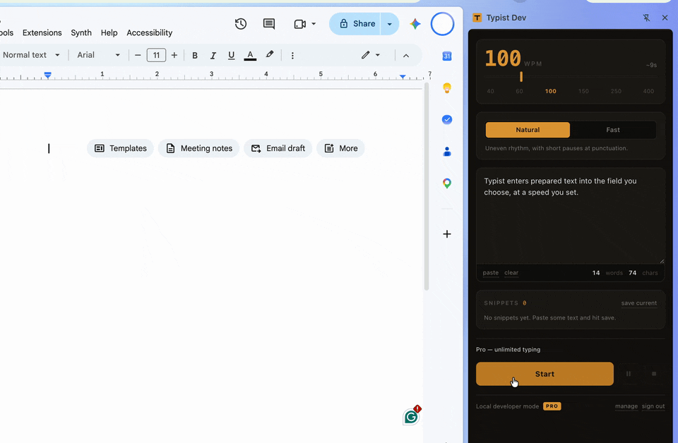

# Typist — case study

**Live product:** [trytypist.com](https://trytypist.com)
**What this repo is:** a write-up of how Typist is built. The extension, API, and billing source are private; this repo contains documentation and a demo recording only.



*Demo recorded with the local developer build (the panel is labelled "Typist Dev").*

## What it does

Typist is a Chrome side panel that types prepared text into a browser field you select, at a speed you set in words per minute.

- Speed from 20 to 400 WPM, with a **Natural** mode (uneven rhythm, short pauses at punctuation) and a **Fast** steady mode
- Pause, resume, and stop mid-run
- Works in plain inputs, textareas, `contenteditable` editors, `designMode` iframes, Google Docs, and Google Slides
- Saved snippets synced to the user's account
- Free tier with a daily word allowance enforced on the server; paid tier via Stripe subscription

**The problem:** pasting a long block of text is instant, but some workflows need text entered at a controlled pace. Examples include live demos and presentations, accessibility setups, and editors or forms that handle a large paste badly. Browser editors differ widely in how they accept input, so "type this text" is harder than it sounds.

## Architecture

```
┌──────────────── Chrome (Manifest V3) ────────────────┐
│ background.js     service worker; opens side panel   │
│ sidepanel.js      UI, settings (chrome.storage)      │
│   └─ injects on demand ─▶ content.js (typing engine) │
│ api.js            Google sign-in via chrome.identity │
└──────────────────────────┬───────────────────────────┘
                           │ HTTPS + session JWT
┌──────────────────────────▼───────────────────────────┐
│ Cloudflare Worker API                                │
│   /auth/google  /me  /usage  /usage/reserve          │
│   /snippets  /billing/checkout  /billing/portal      │
│   /stripe/webhook                                    │
│ Cloudflare D1 (SQLite), 4 migrations: users,         │
│   snippets, daily_usage, usage_reservations,         │
│   webhook_events                                     │
└──────────────────────────┬───────────────────────────┘
                           │ REST
                        Stripe
Marketing site: static HTML on Cloudflare Pages
```

| Layer | Stack |
|---|---|
| Extension | Plain JavaScript, Manifest V3, no build step |
| API | Cloudflare Workers, D1 (SQLite), Wrangler |
| Auth | Google OAuth token → verified server-side → HMAC-signed session JWT |
| Billing | Stripe Checkout + Customer Portal, called over REST |
| Site | Static HTML/CSS on Cloudflare Pages, strict CSP (no scripts), HSTS |
| Tests | `node:test`, no third-party test dependencies |

**Design choices**

- **The content script is not declared in the manifest.** The side panel injects it with `chrome.scripting.executeScript` only when the user starts typing, so nothing runs on pages the user never types into.
- **Limits are enforced by the server, not the client.** Before typing, the extension reserves a word count from the API. The reservation is one atomic D1 batch keyed by a request ID (`ON CONFLICT(request_id)`), so a retried request can't double-charge the allowance.
- **No license keys.** The paid plan is attached to the signed-in Google account. The client treats cached account status as fresh for 72 hours and falls back to the last known status on a network error, so a brief outage doesn't break the UI. Typing itself still requires a server reservation.
- **CORS on the API is locked to the extension ID.**

## Engineering challenges

**1. Every editor accepts input differently.** Plain inputs and textareas take the native value setter plus an `input` event (see 2). `contenteditable` editors are different. The engine dispatches `beforeinput` first, falls back to `document.execCommand('insertText')`, then to a bare `input` event, and never writes the DOM by hand. After each step it checks whether text actually landed (caret position and text length), because some editors accept both paths and would otherwise receive every character twice.

**2. React-style controlled inputs ignore `element.value = x`.** Frameworks track the value through the prototype setter. The engine calls the native `HTMLInputElement`/`HTMLTextAreaElement` value setter, looked up for the element's own frame, so the framework sees the change.

**3. Google Docs renders to a canvas.** There is no editable DOM to type into. Docs listens on a hidden `.docs-texteventtarget-iframe`. The engine targets that iframe and re-locates it if Docs re-renders mid-run.

**4. Key codes matter.** Using a character's char code as its `keyCode` breaks Google Docs: `%` (37) and `!` (33) are read as ArrowLeft and PageUp and move the cursor. Key events carry the physical US-layout key code for each character instead.

**5. Frames.** The engine walks same-origin iframes (up to two levels deep) and `designMode` documents. When the target editor is in a cross-origin frame it can't access, it tells the user rather than failing silently.

**6. Billing correctness.** Stripe webhooks are verified with HMAC-SHA256, a constant-time comparison, and a 5-minute timestamp tolerance. Each event ID is claimed with a short lease and marked done after processing, so a redelivered webhook that already succeeded is a no-op. Customer and Checkout creation calls to Stripe use idempotency keys.

**A scope decision.** An early build had a "typo injector" that made and corrected mistakes. I removed it: deliberately faking errors only serves to disguise automated input, which is not what the product is for. The engine varies timing for a natural rhythm but types the text exactly as given.

## Testing

- **Extension engine:** 82 tests across 4 files. They cover editor input paths, punctuation and key codes, targeting, and the safety gate. They run against a small hand-written DOM harness under `node --test`.
- **API:** 227 tests across 8 files, covering auth, billing, billing hardening, webhooks, usage reservation, word counting, side-panel modal behaviour, and privacy disclosure.
- **Manual QA:** a written release checklist for behaviour that is hard to automate (real Google Docs and other rich editors).
- **Gap:** no CI yet; tests run locally before each release.

## What I learned

- Browser input is not a single API. Each editor family needs its own path, and the order of fallbacks is a correctness issue, not just a compatibility one.
- Anything that gates access or money must be enforced and made idempotent on the server. The client is only a cache.
- Manifest V3 pushes toward least privilege: short-lived service workers and on-demand injection. Designing for that early was easier than retrofitting it.
- Shipping a paid product brings obligations that aren't code: store review, a privacy disclosure, terms, and refunds.

## What I would improve next

- Add CI (GitHub Actions running both test suites on every push). A stale UI-copy assertion once went unnoticed between local runs; CI would have caught it immediately.
- Replace the hand-written DOM harness with a small Playwright suite against real editors (Docs, a React form, a `contenteditable` editor).
- Add structured error reporting on the Worker so failed reservations and webhook errors are visible without reading logs.
- Have the legal pages (terms, refunds) reviewed rather than relying on templates.

---
*Source for the extension, API, and billing integration is kept private. Happy to walk through it in an interview.*
